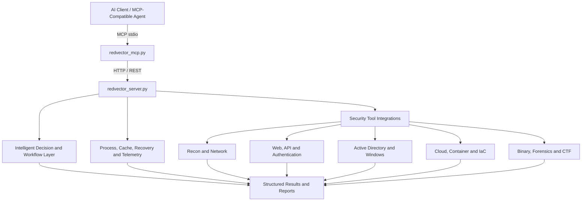

<div align="center">


# RedVector AI v8.0

### Official Website

https://0x7ak7.github.io/RedVector/

### AI-Assisted Cybersecurity Automation, Penetration Testing and Red Team Orchestration

[](https://www.python.org/)
[](LICENSE)
[](#complete-mcp-tool-index)
[](#architecture)
[](#legal-and-ethical-use)

**Developed and maintained by Adam Karim**

RedVector connects MCP-compatible AI clients with a large collection of real cybersecurity tools through a Python MCP layer and a Flask execution backend.

[Overview](#overview) • [Architecture](#architecture) • [Installation](#installation) • [Security Tools](#security-tools) • [AI Systems](#ai-systems-and-workflow-components) • [Workflow](#how-redvector-works) • [MCP Tools](#complete-mcp-tool-index) • [License](#license)

</div>

---

## Overview

RedVector AI is an AI-assisted cybersecurity automation platform for authorized penetration testing, red-team exercises, vulnerability research, CTFs, labs, defensive validation, digital forensics, reverse engineering, cloud and container assessment, Active Directory testing, web and API security, and security-tool orchestration.

The supplied source tree registers **328 MCP tools** in `redvector_mcp.py` and **331 Flask routes** in `redvector_server.py`. The MCP layer exposes structured capabilities to compatible AI clients. The Flask backend performs validation, process execution, orchestration, result collection, caching, recovery, telemetry, reporting, and access to the underlying security tools installed on the host.

RedVector does not magically bundle every third-party executable. A wrapper may exist even when the corresponding tool is not installed. Kali Linux provides the broadest out-of-the-box coverage, while Ubuntu, Debian and other supported environments can also be used with the required tools installed separately.

> **Authorized use only.** Use RedVector only on systems you own or have explicit permission to assess.

---

## Architecture



### Main runtime files

| File | Role |
|---|---|
| `redvector_server.py` | Flask backend, orchestration, security-tool execution, autonomous workflows, process management and reporting |
| `redvector_mcp.py` | FastMCP interface exposing RedVector capabilities to AI clients |
| `redvector-mcp.json` | Example MCP configuration |
| `ollama-mcp.json` | Example local/Ollama-oriented MCP configuration |
| `start_redvector.sh` | Linux launcher, verifies backend ownership, starts backend on demand and runs MCP client |
| `redvector_backend_check.py` | Linux socket/process ownership check used by the launcher |
| `redvector_banner.py` | Shared original terminal banner and startup panel; never starts the backend |
| `install_claude_desktop_kali.sh` | Optional Claude Desktop installer for Kali, Debian and Ubuntu |
| `install_redvector_claude_mcp.sh` | Registers RedVector with Claude Desktop on Linux using its own directory |
| `start_redvector.ps1` | Windows PowerShell launcher |
| `requirements.txt` | Python dependencies |

---

## How RedVector Works

1. **Start the RedVector backend.** The Flask service normally binds to `127.0.0.1:8888`.
2. **Connect an MCP-compatible AI client.** The client launches or connects to `redvector_mcp.py`.
3. **Submit an authorized task.** The AI selects a RedVector MCP capability based on the operator's request.
4. **RedVector validates parameters and scope.** Requests are normalized before execution.
5. **The backend invokes the selected integration.** The corresponding security tool runs on the RedVector host.
6. **Process and recovery systems monitor execution.** Long-running jobs can be cached, monitored, retried, paused, resumed, or terminated where supported.
7. **Results are normalized.** Tool output is returned through the Flask API to the MCP layer.
8. **The AI interprets the result.** The client can explain findings, select a follow-up workflow, generate a report, or call another RedVector capability.

### Typical assessment workflow

```text
Authorized target
      |
      v
Reconnaissance and OSINT
      |
      v
Service and technology identification
      |
      v
Vulnerability discovery and correlation
      |
      v
Validation / exploit research
      |
      v
Controlled exploitation where explicitly authorized
      |
      v
Post-exploitation / privilege escalation / lateral movement where in scope
      |
      v
Evidence, reporting and remediation guidance
```

RedVector also contains specialized workflow managers and autonomous engines for CTF, bug bounty, Active Directory, web vulnerability chaining, cloud assessment, CCTV assessment, exploitation research, privilege escalation, persistence, lateral movement, data exfiltration simulation, fuzzing and related red-team workflows.

---

## Installation

### Kali Linux / Linux

Clone RedVector and install its Python dependencies:

```bash
git clone https://github.com/0x7AK7/RedVector.git
cd RedVector
python3 -m venv .venv
source .venv/bin/activate
python -m pip install --upgrade pip
pip install -r requirements.txt
```

**Choose how to run RedVector:**

- **Claude Desktop integration (recommended for desktop users):** Follow [Claude Desktop automatic setup](#claude-desktop-automatic-setup-kali-linux) below. Do not start `start_redvector.sh` separately when Claude Desktop is configured to launch it.
- **Standalone or another MCP client:** Run `bash start_redvector.sh` in a dedicated terminal. This starts the backend if necessary and launches the MCP client using stdio. For a backend-only session, see below.

Or start the backend directly:

```bash
python redvector_server.py
```

### Claude Desktop automatic setup (Kali Linux)

Claude Desktop on Linux is currently a beta release. Kali Linux is Debian-based, but it is not among Anthropic's officially tested distributions. An x86_64 or arm64 Debian-based desktop is required. If you use **Kali through WSL2**, Anthropic recommends installing Claude Desktop on **Windows** and running sessions in WSL rather than installing the Linux desktop app inside WSL.

The following installers must be included in the cloned RedVector directory before you run them: `install_claude_desktop_kali.sh` and `install_redvector_claude_mcp.sh`. If either is missing from your checkout, obtain it from the project's published installation assets or wait until it has been added to the repository. Do not run a non-existent script.

**One-time setup**, after cloning and installing the Python dependencies above:

```bash
# Install Claude Desktop if it is not already installed.
bash ./install_claude_desktop_kali.sh

# Register RedVector with Claude Desktop automatically.
bash ./install_redvector_claude_mcp.sh
```

The MCP installer locates RedVector from the actual location of its own script, including when called from another working directory or through a symbolic link. You can also pass the RedVector directory explicitly:

```bash
bash /path/to/RedVector/install_redvector_claude_mcp.sh /path/to/RedVector
```

It creates or updates `~/.config/Claude/claude_desktop_config.json`, backs up an existing configuration, and **preserves other MCP server entries**. The generated `redvector-ai` entry launches `start_redvector.sh` using an absolute path. Use your existing API token configuration when applicable; avoid publishing secrets in Git.

**Everyday use**, after fully quitting and restarting Claude Desktop once to load the configuration:

```bash
claude-desktop
```

Claude Desktop is expected to launch RedVector's `start_redvector.sh` automatically through MCP. The launcher resolves its own installation directory (including symbolic links), uses that project's `.venv` Python when available, and verifies the listening process through Linux `/proc` before reusing a backend. It checks `http://127.0.0.1:8888/health`, starts the RedVector backend when the port is free, and runs `redvector_mcp.py` via stdio. A foreign process or unverifiable owner causes a clear error; no process is stopped automatically. You normally **do not need to execute `start_redvector.sh` manually**. The backend may remain running after Claude Desktop closes because the launcher detaches it.

The MCP client obtains tool availability from `/health/details`, including the essential count (for example, `8/8`). Missing or invalid availability fields are reported as `Unknown`. Launcher and MCP diagnostics go to stderr; backend output goes to `server.log`, keeping MCP stdout reserved for the protocol. If ownership cannot be read (for example, restricted `/proc` access or a different user), run the backend under the same user with visible process metadata or resolve the port conflict manually.

When run manually with `bash start_redvector.sh` from an interactive terminal, the launcher also displays the original red logo and startup panel on stderr, including when it reuses this installation's running backend. The server and launcher share the same renderer; displaying the banner does not start another server. The MCP tool count is read from the current registrations. Claude Desktop's piped MCP launch suppresses the banner and keeps stdout exclusively for the protocol.

**Verify the connection:** Open **Claude Desktop → Settings → Developer → Local MCP servers** and check that `redvector-ai` is running. In a Claude chat, request a read-only `server_health` check. Do not assume a reported scan was executed unless the corresponding MCP tool call and output are visible.

**If `redvector-ai` shows Failed:**

```bash
curl -fsS http://127.0.0.1:8888/health
cat ~/.config/Claude/claude_desktop_config.json
ls -lah ~/.config/Claude/logs/
```

Inspect the `redvector-ai` log through **View logs** in Claude Desktop. Ensure the configured project path exists and `start_redvector.sh` is present. Avoid sharing API tokens when pasting configuration or logs publicly.

This setup is for **Claude Desktop**. Claude Code launched independently with the `claude` terminal command may require separate MCP registration.

### Windows PowerShell

```powershell
git clone https://github.com/0x7AK7/RedVector.git
cd RedVector
python -m venv .venv
.\.venv\Scripts\Activate.ps1
python -m pip install --upgrade pip
pip install -r requirements.txt
.\start_redvector.ps1
```

### Verify the backend

```bash
curl http://127.0.0.1:8888/health
```

---

## Configuration

Common environment variables used by the project include:

| Variable | Purpose |
|---|---|
| `REDVECTOR_HOST` / `HOST` | Backend bind address, depending on launcher/runtime path |
| `REDVECTOR_PORT` / `PORT` | Backend port |
| `REDVECTOR_API_TOKEN` | Bearer token used to protect API access |
| `COMMAND_TIMEOUT` | Maximum command execution time where supported |
| `CACHE_TTL` | Cache lifetime |
| `FLASK_DEBUG` | Flask debug setting |

Example:

```bash
export REDVECTOR_API_TOKEN="replace-with-a-strong-random-token"
python redvector_server.py
```

For remote exposure, use appropriate network controls, authentication, TLS termination, and an isolated assessment environment. Binding to localhost is the safest default.

---

## MCP Client Integration

RedVector is designed to work with MCP-compatible AI clients. Examples include Claude-based clients, Cursor, VS Code integrations, local LLM workflows, and other clients capable of launching an MCP stdio server.

Example configuration:

```json
{
  "mcpServers": {
    "redvector": {
      "command": "python",
      "args": ["/absolute/path/to/RedVector/redvector_mcp.py"],
      "env": {
        "REDVECTOR_SERVER": "http://127.0.0.1:8888"
      }
    }
  }
}
```

The repository also contains `redvector-mcp.json` and `ollama-mcp.json` as starting points. Review paths and environment values before use.

---

## Security Tools

RedVector exposes a broad security-tool surface through MCP and REST integrations. The list below is derived from the supplied project documentation and source. Availability depends on what is installed on the host.

### Security Tool Arsenal

<details>
<summary><b>🔍 Network Reconnaissance & Enumeration</b></summary>

<br>

- **Nmap** - Advanced port scanning, service detection, OS fingerprinting, NSE scripting, and network discovery.
- **RustScan** - Ultra-fast port discovery designed to feed identified services into deeper scanning workflows.
- **Masscan** - High-speed large-scale TCP port scanning with configurable rates and banner collection.
- **AutoRecon** - Automated multi-stage reconnaissance and service enumeration across discovered ports.
- **Amass** - Subdomain enumeration, attack-surface mapping, and OSINT-assisted domain discovery.
- **Subfinder** - Fast passive subdomain discovery using multiple public intelligence sources.
- **HTTPx** - HTTP probing, status discovery, title collection, technology identification, and web-service validation.
- **theHarvester** - OSINT collection for domains, hosts, subdomains, email addresses, and public exposure.
- **DNSRecon** - DNS enumeration, record discovery, zone-transfer checks, and brute-force workflows.
- **DNSEnum** - DNS information gathering and subdomain enumeration.
- **Fierce** - DNS reconnaissance and domain-mapping support.
- **Enum4linux** - SMB and Windows host enumeration for users, groups, shares, and policy information.
- **Enum4linux-ng** - Enhanced SMB enumeration with structured output and broader discovery options.
- **SMBMap** - SMB share discovery, permission review, and remote resource enumeration.
- **rpcclient** - RPC-based Windows and Samba enumeration.
- **NBTScan** - NetBIOS name and host discovery across local or remote networks.
- **ARP-Scan** - Layer-2 host discovery using ARP requests.
- **Responder** - LLMNR, NBT-NS, and MDNS analysis for authorized internal-network assessments.
- **NetExec** - Multi-protocol network assessment and Active Directory enumeration framework.
- **Shodan CLI** - Internet-facing asset, service, and exposure discovery through Shodan data.

</details>

<details>
<summary><b>🌐 Web Application Security Testing</b></summary>

<br>

- **Nuclei** - Template-driven vulnerability scanning for web services, exposed technologies, and known security issues.
- **Gobuster** - Directory, file, DNS, and virtual-host enumeration.
- **Dirsearch** - Directory and file discovery with extension, recursion, and threading controls.
- **Feroxbuster** - Recursive web content discovery with filtering and high-performance enumeration.
- **FFuf** - Fast web fuzzing for paths, parameters, virtual hosts, and request components.
- **Dirb** - Traditional web-content discovery using configurable wordlists.
- **Katana** - Modern crawler for endpoint discovery, JavaScript-aware crawling, and form extraction.
- **Hakrawler** - Lightweight web crawling and endpoint enumeration.
- **Gau** - URL collection from public archives and passive sources.
- **Waybackurls** - Historical URL discovery using Wayback Machine data.
- **Nikto** - Web-server configuration and vulnerability assessment.
- **WPScan** - WordPress security assessment, plugin/theme enumeration, and vulnerability discovery.
- **Arjun** - Hidden HTTP parameter discovery.
- **ParamSpider** - Parameter and URL mining from archived web data.
- **x8** - Hidden parameter discovery for web applications and APIs.
- **Jaeles** - Signature-based vulnerability scanning and customizable web assessment workflows.
- **Dalfox** - XSS discovery and analysis with parameter mining and DOM-focused testing.
- **XSSer** - Cross-site scripting assessment and payload testing.
- **Wfuzz** - Flexible web application fuzzing and discovery.
- **DotDotPwn** - Directory traversal assessment.
- **Wafw00f** - Web application firewall identification and fingerprinting.
- **testssl.sh** - TLS/SSL configuration, cipher, and protocol security assessment.
- **Commix** - Command-injection detection and validation for authorized testing.
- **NoSQLMap** - NoSQL injection assessment for supported database technologies.
- **Burp Suite Integration** - Project-based and headless web security assessment integration.
- **OWASP ZAP Integration** - Automated web application scanning and proxy-assisted security testing.

### Advanced Browser Agent

- **Headless browser automation** - Browser-driven inspection for dynamic applications.
- **DOM analysis** - Inspect rendered page structure and client-side behavior.
- **JavaScript execution** - Evaluate dynamic content that traditional HTTP scanners may miss.
- **Form discovery** - Identify forms and input surfaces for further review.
- **Security-header analysis** - Review browser-visible HTTP security controls.
- **Proxy integration** - Route browser traffic through compatible security proxies.
- **Multi-page crawling** - Traverse and map web application surfaces.
- **Screenshot capture** - Preserve visual evidence during authorized assessments.

</details>

<details>
<summary><b>📡 API, GraphQL & JWT Security</b></summary>

<br>

- **API Fuzzer** - Endpoint and parameter discovery across REST-style APIs.
- **GraphQL Scanner** - GraphQL introspection, query-depth, and mutation-focused security assessment.
- **JWT Analyzer** - JSON Web Token structure and security analysis.
- **API Schema Analyzer** - Review OpenAPI or other supported schemas for exposed operations and security concerns.
- **Comprehensive API Audit** - Combine schema, JWT, endpoint, and GraphQL analysis into one workflow.
- **Burp Suite / OWASP ZAP** - Proxy-assisted API inspection and automated security testing.

</details>

<details>
<summary><b>🔐 Authentication & Credential Auditing</b></summary>

<br>

- **Hydra** - Multi-protocol authentication testing for authorized credential audits.
- **John the Ripper** - Password-hash auditing with wordlists, rules, and supported hash formats.
- **Hashcat** - High-performance password recovery and hash auditing with CPU/GPU acceleration.
- **LaZagne** - Credential-recovery auditing from supported local applications and system locations.
- **Kerbrute** - Kerberos-focused user and authentication testing in authorized Active Directory environments.
- **Evil-WinRM** - WinRM administration and authorized Windows remote-access workflows.
- **Mimikatz Integration** - Windows credential-security assessment in controlled environments.

</details>

<details>
<summary><b>🪟 Active Directory & Windows Security</b></summary>

<br>

- **NetExec** - SMB, WinRM, LDAP, and related protocol assessment for Windows enterprise environments.
- **Impacket PsExec** - SMB-based remote administration and validation workflows.
- **Impacket WMIExec** - WMI-based remote administration and testing.
- **Impacket SMBExec** - SMB service-based remote execution workflows for authorized assessments.
- **Impacket SecretsDump** - Credential-store and directory-security assessment in controlled environments.
- **BloodHound** - Active Directory relationship collection and attack-path analysis.
- **Kerbrute** - Kerberos user enumeration and authentication-security testing.
- **Evil-WinRM** - Windows Remote Management access and administration testing.
- **SMBMap** - Share discovery and SMB permission analysis.
- **rpcclient / Enum4linux-ng** - Windows and Samba enumeration through RPC and SMB interfaces.

</details>

<details>
<summary><b>🔬 Binary Analysis & Reverse Engineering</b></summary>

<br>

- **GDB** - GNU debugger for low-level program analysis and debugging.
- **GDB-PEDA** - Exploit-development assistance and enhanced GDB analysis.
- **Radare2** - Reverse engineering, disassembly, binary inspection, and scripting.
- **Ghidra** - Advanced static analysis and reverse engineering with headless workflow support.
- **Binwalk** - Firmware, embedded-file, and binary-content analysis.
- **ROPgadget** - ROP/JOP gadget discovery for binary-security research.
- **Ropper** - Gadget discovery and binary exploitation research.
- **Checksec** - Inspect executable security protections such as NX, PIE, RELRO, and stack canaries.
- **Strings** - Extract readable string content from binaries.
- **Objdump** - Object-file inspection and disassembly.
- **XXD** - Hexadecimal file inspection.
- **Pwntools** - Python framework for CTF and binary-security research.
- **angr** - Program analysis and symbolic execution.
- **one_gadget** - libc gadget discovery for controlled exploit-development research.
- **libc-database** - libc identification and symbol-offset lookup.
- **pwninit** - Binary-analysis environment preparation for CTF and lab workflows.
- **Linux Exploit Suggester** - Kernel and local privilege-escalation research based on system information.
- **Windows Exploit Suggester** - Windows patch-gap and local vulnerability research.
- **MSFVenom** - Payload generation for controlled lab and authorized testing environments.

</details>

<details>
<summary><b>☁️ Cloud, Container & Kubernetes Security</b></summary>

<br>

- **Prowler** - AWS, Azure, and GCP security assessment and compliance review.
- **Scout Suite** - Multi-cloud security auditing and configuration analysis.
- **CloudMapper** - AWS network visualization and cloud architecture security analysis.
- **Pacu** - AWS security research and controlled cloud assessment framework.
- **Trivy** - Vulnerability and misconfiguration scanning for containers, filesystems, repositories, and IaC.
- **Clair** - Container image vulnerability analysis.
- **Kube-Hunter** - Kubernetes security assessment and exposure discovery.
- **Kube-Bench** - CIS Kubernetes benchmark validation.
- **Docker Bench for Security** - Docker host and daemon security checks based on CIS guidance.
- **Falco** - Runtime security monitoring for containers and Kubernetes.
- **Checkov** - Infrastructure-as-code security and policy scanning.
- **Terrascan** - IaC misconfiguration and policy-as-code analysis.

</details>

<details>
<summary><b>🏆 Digital Forensics, CTF & Steganography</b></summary>

<br>

- **Volatility** - Memory-forensics analysis with plugin-based investigation workflows.
- **Volatility 3** - Modern memory-forensics framework for supported memory images.
- **Foremost** - Signature-based file carving and recovery.
- **Steghide** - Steganography embedding and extraction analysis.
- **ExifTool** - Metadata extraction and inspection across a wide range of file formats.
- **Binwalk** - Firmware extraction and embedded-content analysis.
- **HashPump** - Hash length-extension research for supported algorithms.
- **John the Ripper / Hashcat** - Hash analysis and password-recovery workflows for CTF and forensic labs.
- **Pwntools** - CTF-oriented exploitation and challenge automation.
- **RedVector CTF Workflows** - Structured challenge analysis, tool recommendation, cryptography assistance, and forensic triage.

</details>

<details>
<summary><b>🔥 OSINT & Attack-Surface Discovery</b></summary>

<br>

- **Shodan** - Internet-connected device and exposed-service discovery.
- **Amass** - Domain and attack-surface mapping.
- **Subfinder** - Passive subdomain discovery.
- **theHarvester** - Public email, host, and domain intelligence collection.
- **DNSRecon / DNSEnum / Fierce** - DNS reconnaissance and domain infrastructure mapping.
- **Gau / Waybackurls** - Historical and archived URL discovery.
- **HTTPx** - Validate discovered web services and identify technologies.
- **Katana / Hakrawler** - Crawl public web surfaces and collect endpoints.

</details>

---

## AI Systems and Workflow Components

RedVector's AI-facing behavior is built around MCP tool exposure plus backend workflow, decision, recovery and autonomous execution components. The AI model itself remains outside the security-tool execution boundary: the client selects structured MCP tools, while RedVector performs the actual backend execution.

### Core decision, workflow, recovery and analysis components

- **`ModernVisualEngine`**
- **`IntelligentDecisionEngine`**
- **`RecoveryAction`**
- **`RecoveryStrategy`**
- **`BugBountyWorkflowManager`**
- **`CTFWorkflowManager`**
- **`CTFToolManager`**
- **`CTFChallengeAutomator`**
- **`CTFTeamCoordinator`**
- **`TechnologyDetector`**
- **`RateLimitDetector`**
- **`FailureRecoverySystem`**
- **`PerformanceMonitor`**
- **`ParameterOptimizer`**
- **`EnhancedProcessManager`**
- **`ResourceMonitor`**
- **`_LazyEnhancedProcessManagerProxy`**
- **`ProcessManager`**
- **`PythonEnvironmentManager`**
- **`CVEIntelligenceManager`**
- **`VulnerabilityCorrelator`**
- **`FileOperationsManager`**
- **`BrowserAgent`**
- **`AdaptiveEvasionEngine`**

### Autonomous assessment and red-team engines

- **`AutonomousExecutionBridge`**
- **`AutonomousReconToShell`**
- **`AutonomousADDomination`**
- **`AutonomousSQLiScanner`**
- **`AutonomousWebVulnChaining`**
- **`AutonomousPersistenceC2`**
- **`AutonomousExploitEngine`**
- **`AutonomousSQLMapExfiltrator`**
- **`AutonomousRCEEngine`**
- **`AutonomousPrivEscPersistenceEngine`**
- **`AutonomousDataExfilEngine`**
- **`AutonomousLateralMovementEngine`**
- **`AutonomousOWASPTop10Engine`**
- **`AutonomousCloudAttackEngine`**
- **`AutonomousZeroDayFuzzEngine`**
- **`AutonomousCCTVFullAssessment`**
- **`AutonomousCCTVNetworkSegmentation`**
- **`AutonomousCCTVOnvifEnum`**
- **`AutonomousCCTVExposureScorecard`**
- **`AutonomousCCTVStreamInterceptor`**
- **`AutonomousCCTVAntiLockout`**
- **`AutonomousCCTVFirmwareBackdoor`**
- **`AutonomousCCTVCloudP2P`**
- **`AutonomousCCTVVideoTamper`**
- **`AutonomousCCTVZeroDayDiscovery`**
- **`AutonomousCCTVShodanDiscovery`**
- **`AutonomousCCTVProxyBruteForce`**
- **`AutonomousCCTVHydraRTSP`**
- **`AutonomousCCTVFingerprint`**
- **`AutonomousCCTVAuthBypass`**
- **`AutonomousCCTVBufferOverflowRCE`**
- **`AutonomousLinuxPrivEsc`**
- **`AutonomousOffensiveChainEngine`**

### AI client and local-model workflows

RedVector can be driven by any compatible MCP client. The repository includes a local/Ollama configuration example, but the MCP design is not limited to Ollama. The typical pattern is:

```text
AI model / AI client
        |
        v
MCP client runtime
        |
        v
redvector_mcp.py
        |
        v
redvector_server.py
        |
        v
Authorized security tools and workflow engines
```

This separation lets the AI handle natural-language planning and interpretation while RedVector keeps tool invocation, parameters, execution and results in a structured interface.

---

## Workflow Components in Practice

### Reconnaissance and discovery

Network discovery, port scanning, service detection, subdomain enumeration, DNS analysis, HTTP probing, OSINT, SMB enumeration and related tasks can be composed into larger workflows.

### Vulnerability identification

Template scanners, service-specific scanners, web testing tools, API scanners, TLS assessment, vulnerability intelligence, CMS scanners and cloud/container scanners can be used individually or as part of orchestrated workflows.

### Exploit research and validation

RedVector includes CVE intelligence, exploit research, Metasploit-oriented integrations, binary-analysis tooling and controlled exploit orchestration. Operators remain responsible for scope and authorization.

### Post-exploitation and enterprise workflows

The project includes Windows, Active Directory, credential-audit, privilege-escalation, lateral-movement, persistence and process-management capabilities intended for controlled red-team environments.

### Cloud, container and IaC

Prowler, Scout Suite, Trivy, kube-hunter, kube-bench, Docker Bench, Falco, Checkov, Terrascan and related integrations support cloud, Kubernetes, container and infrastructure-as-code assessment.

### Reverse engineering, CTF and forensics

GDB, Radare2, Ghidra, Binwalk, ROP tooling, Pwntools, angr, Volatility, ExifTool and other integrations support binary research, firmware analysis, forensics and CTF workflows.

### Browser and web automation

`BrowserAgent` and proxy/browser integrations support dynamic web analysis, DOM inspection, form discovery, JavaScript-aware workflows, screenshots and proxy-assisted testing.

---

## Complete MCP Tool Index

The supplied `redvector_mcp.py` registers **328 MCP tools**. The complete function-level tool surface is listed below so users can discover exactly what the AI client can call.

<details>
<summary><b>Show all 328 MCP tools</b></summary>

- `nmap_scan`
- `gobuster_scan`
- `nuclei_scan`
- `prowler_scan`
- `trivy_scan`
- `scout_suite_assessment`
- `cloudmapper_analysis`
- `pacu_exploitation`
- `kube_hunter_scan`
- `kube_bench_cis`
- `docker_bench_security_scan`
- `clair_vulnerability_scan`
- `falco_runtime_monitoring`
- `checkov_iac_scan`
- `terrascan_iac_scan`
- `create_file`
- `modify_file`
- `delete_file`
- `list_files`
- `generate_payload`
- `install_python_package`
- `execute_python_script`
- `dirb_scan`
- `nikto_scan`
- `sqlmap_scan`
- `metasploit_run`
- `hydra_attack`
- `john_crack`
- `wpscan_analyze`
- `enum4linux_scan`
- `ffuf_scan`
- `netexec_scan`
- `amass_scan`
- `hashcat_crack`
- `subfinder_scan`
- `smbmap_scan`
- `rustscan_fast_scan`
- `masscan_high_speed`
- `nmap_advanced_scan`
- `enum4linux_ng_advanced`
- `rpcclient_enumeration`
- `nbtscan_netbios`
- `arp_scan_discovery`
- `responder_credential_harvest`
- `volatility_analyze`
- `msfvenom_generate`
- `gdb_analyze`
- `radare2_analyze`
- `binwalk_analyze`
- `ropgadget_search`
- `checksec_analyze`
- `xxd_hexdump`
- `strings_extract`
- `objdump_analyze`
- `ghidra_analysis`
- `pwntools_exploit`
- `one_gadget_search`
- `libc_database_lookup`
- `gdb_peda_debug`
- `angr_symbolic_execution`
- `ropper_gadget_search`
- `pwninit_setup`
- `feroxbuster_scan`
- `dotdotpwn_scan`
- `xsser_scan`
- `wfuzz_scan`
- `dirsearch_scan`
- `katana_crawl`
- `gau_discovery`
- `waybackurls_discovery`
- `arjun_parameter_discovery`
- `paramspider_mining`
- `x8_parameter_discovery`
- `jaeles_vulnerability_scan`
- `dalfox_xss_scan`
- `httpx_probe`
- `anew_data_processing`
- `qsreplace_parameter_replacement`
- `uro_url_filtering`
- `ai_generate_payload`
- `ai_test_payload`
- `ai_generate_attack_suite`
- `api_fuzzer`
- `graphql_scanner`
- `jwt_analyzer`
- `api_schema_analyzer`
- `comprehensive_api_audit`
- `volatility3_analyze`
- `foremost_carving`
- `steghide_analysis`
- `exiftool_extract`
- `hashpump_attack`
- `hakrawler_crawl`
- `burpsuite_scan`
- `zap_scan`
- `wafw00f_scan`
- `fierce_scan`
- `dnsenum_scan`
- `autorecon_scan`
- `server_health`
- `get_cache_stats`
- `clear_cache`
- `get_telemetry`
- `list_active_processes`
- `get_process_status`
- `terminate_process`
- `pause_process`
- `resume_process`
- `get_process_dashboard`
- `execute_command`
- `monitor_cve_feeds`
- `generate_exploit_from_cve`
- `discover_attack_chains`
- `research_zero_day_opportunities`
- `correlate_threat_intelligence`
- `advanced_payload_generation`
- `vulnerability_intelligence_dashboard`
- `threat_hunting_assistant`
- `get_live_dashboard`
- `create_vulnerability_report`
- `format_tool_output_visual`
- `create_scan_summary`
- `display_system_metrics`
- `analyze_target_intelligence`
- `select_optimal_tools_ai`
- `optimize_tool_parameters_ai`
- `create_attack_chain_ai`
- `intelligent_smart_scan`
- `detect_technologies_ai`
- `ai_reconnaissance_workflow`
- `ai_vulnerability_assessment`
- `bugbounty_reconnaissance_workflow`
- `bugbounty_vulnerability_hunting`
- `bugbounty_business_logic_testing`
- `bugbounty_osint_gathering`
- `bugbounty_file_upload_testing`
- `bugbounty_comprehensive_assessment`
- `bugbounty_authentication_bypass_testing`
- `http_framework_test`
- `browser_agent_inspect`
- `http_set_rules`
- `http_set_scope`
- `http_repeater`
- `http_intruder`
- `burpsuite_alternative_scan`
- `error_handling_statistics`
- `test_error_recovery`
- `ctf_create_challenge_workflow`
- `ctf_auto_solve`
- `ctf_team_strategy`
- `ctf_suggest_tools`
- `ctf_crypto_solver`
- `ctf_forensics_analyzer`
- `ctf_binary_analyzer`
- `linpeas_scan`
- `winpeas_scan`
- `linux_exploit_suggester_scan`
- `windows_exploit_suggester_scan`
- `gtfobins_lookup`
- `lolbas_lookup`
- `pspy_monitor`
- `sudo_misconfiguration_check`
- `suid_sgid_finder`
- `impacket_psexec`
- `impacket_wmiexec`
- `impacket_smbexec`
- `impacket_secretsdump`
- `evil_winrm_connect`
- `bloodhound_collection`
- `kerbrute_attack`
- `chisel_tunnel`
- `ligolo_tunnel`
- `proxychains_execute`
- `ssh_tunnel_setup`
- `mimikatz_execute`
- `persistence_install`
- `reverse_shell_generate`
- `theharvester_scan`
- `whois_lookup`
- `dnsrecon_scan`
- `shodan_search`
- `sherlock_username_search`
- `testssl_scan`
- `commix_scan`
- `nosqlmap_scan`
- `searchsploit_lookup`
- `metasploit_module_search`
- `netexec_execute`
- `payload_stage`
- `lazagne_harvest`
- `tshark_capture`
- `tcpdump_capture`
- `powersploit_execute`
- `autonomous_recon_to_shell`
- `evasion_analyze_defenses`
- `evasion_generate_payload`
- `autonomous_ad_domination`
- `web_vuln_chain_discover`
- `web_vuln_chain_exploit`
- `persistence_deploy`
- `c2_channel_config`
- `autonomous_sqli_scan`
- `autonomous_exploit_engine`
- `exploit_select`
- `exploit_generate_payload`
- `post_exploit_playbook`
- `autonomous_sqlmap_exfiltration`
- `sqlmap_enumerate_databases`
- `sqlmap_dump_table`
- `sqlmap_extract_credentials`
- `sqlmap_manipulate_records`
- `autonomous_rce_pipeline`
- `autonomous_rce_detect`
- `autonomous_rce_shells`
- `autonomous_rce_playbook`
- `autonomous_rce_cve_check`
- `autonomous_privesc_pipeline`
- `autonomous_privesc_enumerate`
- `autonomous_privesc_persist`
- `autonomous_privesc_services`
- `autonomous_privesc_security`
- `autonomous_exfil_pipeline`
- `autonomous_exfil_files`
- `autonomous_exfil_env`
- `autonomous_exfil_cloud`
- `autonomous_exfil_memory`
- `autonomous_lateral_pipeline`
- `autonomous_lateral_creds`
- `autonomous_lateral_enum`
- `autonomous_lateral_protocols`
- `autonomous_lateral_hash`
- `autonomous_owasp_pipeline`
- `autonomous_owasp_scan`
- `autonomous_owasp_exploit`
- `autonomous_owasp_report`
- `autonomous_owasp_remediate`
- `autonomous_cloud_pipeline`
- `autonomous_cloud_iam`
- `autonomous_cloud_storage`
- `autonomous_cloud_serverless`
- `autonomous_cloud_container`
- `autonomous_fuzz_pipeline`
- `autonomous_fuzz_strategies`
- `autonomous_fuzz_crashes`
- `autonomous_fuzz_protocols`
- `autonomous_fuzz_analyze`
- `cctv_discovery`
- `cctv_default_creds`
- `cctv_rtsp_probe`
- `cctv_firmware_cve`
- `cctv_config_audit`
- `autonomous_cctv_pipeline`
- `autonomous_cctv_quick_scan`
- `autonomous_cctv_segmentation`
- `autonomous_cctv_segmentation_services`
- `autonomous_cctv_onvif_enum`
- `autonomous_cctv_onvif_actions`
- `autonomous_cctv_scorecard`
- `autonomous_cctv_scorecard_dimensions`
- `autonomous_cctv_stream_analyze`
- `autonomous_cctv_stream_evidence`
- `autonomous_cctv_stream_protocols`
- `autonomous_cctv_antilockout_spray`
- `autonomous_cctv_antilockout_throttle`
- `autonomous_cctv_antilockout_crossproto`
- `autonomous_cctv_antilockout_fingerprint`
- `autonomous_cctv_antilockout_passive`
- `autonomous_cctv_antilockout_strategies`
- `autonomous_cctv_antilockout_policies`
- `autonomous_cctv_firmware_backdoor_scan`
- `autonomous_cctv_firmware_debug_ports`
- `autonomous_cctv_firmware_extract_creds`
- `autonomous_cctv_firmware_supply_chain`
- `autonomous_cctv_firmware_backdoors_list`
- `autonomous_cctv_cloud_p2p_scan`
- `autonomous_cctv_cloud_p2p_uid_enum`
- `autonomous_cctv_cloud_p2p_api_test`
- `autonomous_cctv_cloud_p2p_intercept`
- `autonomous_cctv_cloud_p2p_providers`
- `autonomous_cctv_video_tamper_ptz_hijack`
- `autonomous_cctv_video_tamper_alerts`
- `autonomous_cctv_video_tamper_timestamps`
- `autonomous_cctv_video_tamper_replay`
- `autonomous_cctv_video_tamper_techniques`
- `autonomous_cctv_zeroday_discover`
- `autonomous_cctv_zeroday_surfaces`
- `autonomous_cctv_shodan_search`
- `autonomous_cctv_shodan_vulnerable`
- `autonomous_cctv_shodan_dorks`
- `autonomous_cctv_proxy_bruteforce`
- `autonomous_cctv_proxy_verify`
- `autonomous_cctv_proxy_config`
- `autonomous_cctv_hydra_rtsp`
- `autonomous_cctv_hydra_rtsp_verify`
- `autonomous_cctv_hydra_rtsp_config`
- `autonomous_cctv_fingerprint`
- `autonomous_cctv_fingerprint_manufacturers`
- `autonomous_cctv_auth_bypass`
- `autonomous_cctv_auth_bypass_cve`
- `autonomous_cctv_auth_bypass_endpoints`
- `autonomous_cctv_overflow_scan`
- `autonomous_cctv_overflow_rce_cve`
- `autonomous_cctv_overflow_vectors`
- `autonomous_linux_privesc_scan`
- `autonomous_linux_privesc_suid`
- `autonomous_linux_privesc_sudo`
- `autonomous_linux_privesc_cron`
- `autonomous_linux_privesc_kernel`
- `autonomous_linux_privesc_permissions`
- `autonomous_linux_privesc_tools`
- `autonomous_linux_privesc_vectors`
- `autonomous_offensive_chain`
- `autonomous_offensive_recon`
- `autonomous_offensive_exploit`
- `autonomous_offensive_privesc`
- `autonomous_offensive_persistence`
- `autonomous_offensive_lateral`
- `autonomous_offensive_exfiltration`
- `autonomous_offensive_backdoor`
- `autonomous_offensive_cleanup`
- `autonomous_offensive_lifecycle`
- `llm_list_models`
- `llm_chat`
- `llm_analyze_scan`
- `llm_suggest_exploits`
- `llm_write_report`
- `llm_config_get`
- `llm_config_set`

</details>

---

## Process Management, Caching and Observability

RedVector includes process and resource monitoring, smart caching, telemetry, dashboards, failure recovery and execution management. These capabilities are useful when scanners or analysis jobs run for a long time or need to be inspected by an AI client.

Examples exposed in the MCP surface include process listing/status, pause/resume/terminate operations, cache statistics, telemetry and dashboard endpoints. Exact callable names are available in the complete MCP index above.

---

## Security Design Notes

RedVector connects AI-driven workflows to powerful operating-system and cybersecurity tooling. Treat the backend as a privileged security component.

Recommended deployment practices:

- Run RedVector in a dedicated Kali VM, security workstation, container, or isolated lab.
- Bind to localhost unless remote access is explicitly required.
- Protect remote API access with authentication and network controls.
- Keep assessment scope documented and explicit.
- Review high-impact operations before execution.
- Keep third-party tools and Python dependencies patched.
- Use least-privilege credentials whenever possible.
- Do not expose the backend directly to the public Internet.

The source also contains request validation, target sanitization, bearer-token support, sensitive-value redaction, process controls, caching and recovery mechanisms. These reduce operational risk but do not replace isolation, authorization and operator judgment.

---

## Project Structure

The clean public repository is intentionally small:

```text
RedVector/
├── assets/
│   └── Redvector-logo4.png
├── LICENSE
├── README.md
├── THIRD_PARTY_NOTICES.md
├── requirements.txt
├── redvector_server.py
├── redvector_mcp.py
├── redvector-mcp.json
├── ollama-mcp.json
├── start_redvector.sh
├── redvector_backend_check.py
├── redvector_banner.py
├── install_claude_desktop_kali.sh
├── install_redvector_claude_mcp.sh
├── start_redvector.ps1
└── .gitignore
```

Development tests, historical pytest output, debug files, internal guides, caches, logs and local working artifacts are intentionally excluded from the public repository.

---

## Troubleshooting

### Backend does not start

```bash
python --version
pip install -r requirements.txt
python redvector_server.py
```

### A security tool is missing

Verify that the executable exists in your environment, for example:

```bash
which nmap
which nuclei
which ffuf
```

Install missing third-party tools from their official package or upstream project.

### MCP client cannot connect

Check that:

1. `redvector_server.py` is running.
2. The MCP configuration points to the correct absolute path for either `start_redvector.sh` (automatic Claude Desktop setup) or `redvector_mcp.py` (direct integration).
3. The client uses the intended Python environment.
4. The configured backend host and port match the running server.
5. The AI client has been restarted after changing MCP configuration.

---

## Legal and Ethical Use

RedVector is intended for:

- authorized penetration testing
- approved red-team exercises
- defensive security validation
- cybersecurity labs and education
- CTF environments
- vulnerability research on owned or explicitly authorized systems
- digital forensics on lawfully obtained data
- bug-bounty testing within published program scope

Do not use RedVector for unauthorized access, credential theft, destructive operations outside an approved scope, or testing third-party systems without permission.

The operator is responsible for obtaining authorization and complying with applicable law, contracts, policies and rules of engagement.

---

## License

[Read License](LICENSE)

---

## Author

**Adam Karim**  
Cybersecurity and Information Security  
GitHub: [0x7AK7](https://github.com/0x7AK7)

---

<div align="center">

**RedVector AI v8.0**  
AI-Assisted Cybersecurity Automation and Red Team Orchestration

</div>


## Automatic Ollama Integration

Run in Kali Linux (Debian/Ubuntu are also supported), with Bash, Python 3.10+,
python3-venv, curl, sufficient model storage and RAM. The installer offers to
create the project .venv and install backend/Ollama Python dependencies when missing.
Both requirement files and required MCP client APIs are checked before startup. The new scripts use LF line endings. When the preserved existing launcher
contains CRLF, the new bridge runs a private temporary LF copy beside it,
preserving its project-path behavior and leaving the original file unchanged.

```bash
bash install_redvector_ollama.sh
```

The English terminal wizard reuses the original RedVector artwork. It detects
Ollama, offers its official Linux installer with an explicit review/confirmation
step, and provides five model choices: Qwen3 8B
(`qwen3:8b`, approximately 5.2 GB), Qwen3-Coder 30B
(`qwen3-coder:30b`, approximately 19 GB), GPT-OSS 20B (`gpt-oss:20b`,
approximately 14 GB), a custom identifier, or an already installed model.
Back and Exit are separate navigation choices.

A model is downloaded only after selection, resource checks and confirmation.
Existing models are reused. To explicitly update an installed model, run
`ollama pull MODEL:TAG`, then select it again. Pull progress is Ollama's native
output; interrupted downloads can be resumed by repeating the selection.
If registry size metadata is unavailable, supply a conservative download budget.
The wizard identifies the configured local API and resolves the serving process,
its effective environment, or matching systemd configuration. It supports
custom service users and units, user-managed units, process-local overrides,
non-default homes and numeric UIDs without a resolvable username. An existing
service's environment takes precedence over the caller's shell. Its model
directory is never guessed from a tester's username or installation path.

Capacity is separate from permission to list/read/write model files. A fixed
metadata-only probe pins the actual blob and manifest directories independently,
follows symlinks without suppressing traversal failures, and measures their
filesystem availability. Proven missing tails may use their resolved existing
parent; denied traversal, loops and untriggered automounts never silently fall
back to another filesystem. Blob/manifest budgets are combined when they share
a filesystem. Temporary/operational headroom is included.

The English preflight shows real API connectivity, selected model, required
download, detected storage, measured or unknown capacity and tool-call status.
Filesystem availability is a snapshot, not a reservation or guarantee.
Service-account/project quotas and other runtime restrictions are labeled
unverified unless a filesystem itself reports a limit through available space.

For private traversal or restricted metadata, cancellation is the default.
Where verified process/UID information and trusted tools are available, the
operator may explicitly approve a limited read-only check as that service UID.
This uses an isolated interpreter, fixed source and no shell, namespace entry,
permission repair or service restart. It does not require running the whole
installer with sudo. If capacity remains unknown, only the explicit word
UNVERIFIED followed by the normal download confirmation allows Ollama to attempt
the pull; its service may still reject it. Verified insufficient space or a
read-only filesystem always stops the attempt and cannot use this fallback.
Cancelling returns to the startup menu instead of an installation retry loop.

Only Ollama's official CLI/API manages model files. Existing models are reused.
Remote endpoints remain blocked by the local-only policy. Known forwarders never
use client disk space as server capacity, and unknown process location is not
presented as a verified local engine. A manual path is requested only when
automatic storage discovery is inconclusive; it may also be left explicitly
unknown. Ownership and permissions are never changed to make validation pass.

See [service-owned storage capacity validation](docs/ollama-capacity-validation.md)
for architecture, representative portability cases, actual results and limits.

Start subsequent sessions with:

```bash
bash start_redvector_ollama.sh
```

The startup menu supports model switching, system status, installed models, a
real MCP connection test, and interactive sessions. The bridge launches the
existing `start_redvector.sh` through its private transient adapter. Only that
adapter selects the Ollama-specific compatible-backend verifier; the original
launcher and Claude behavior stay unchanged. Authentication, health checks and
stdio transport remain enforced. It initializes MCP and discovers the actual
tool count. No Claude Desktop configuration, original launcher, backend, tool
registration or GitHub Pages file is changed.

**Model capabilities differ.** Installation alone does not demonstrate tool
calling. The agent requires Ollama's advertised `tools` capability and a valid
harmless tool-call format probe. Dolphin models may advertise completion only;
these cannot enable agent mode. MCP diagnostics still work independently.
Third-party security executables such as Nmap and WHOIS must be installed
separately; the wizard does not install them.

In the interactive session:

- `/status` invokes the real read-only health tool.
- `/tools QUERY` discovers registered tools without sending all verbose schemas
  to the model.
- `/scope` replaces the explicitly authorized, session-local IP/CIDR/hostname
  scope. Installation never asks for a target.
- `/back` returns to the startup menu to change models.

All 328 existing MCP handlers remain available to existing clients. This new
agent discovers them but applies a narrow reviewed execution policy: read-only
`server_health` and `get_cache_stats`; scoped WHOIS; scoped numeric-IPv4 Nmap TCP
connect scans with fixed arguments; and separately approved local cache clearing.
Every assessment and state change requires approval of its displayed arguments.
Nmap retains the existing backend's recovery/retry behavior within the same
target scope. Other tools, arbitrary commands, scripts, payloads and autonomous
compound operations are discoverable but blocked in this agent until they have
a reviewed execution policy. Active scans require numeric IPv4 scope to avoid
hostname-resolution ambiguity; IPv6 scanning is explicitly disabled pending a
reviewed invocation policy. Targets are never authorized by model text.

New Ollama services bind to localhost. The client accepts local HTTP endpoints
only, bypasses proxies and rejects redirects. Backend API tokens are inherited
using the existing environment behavior and are never saved in the model
configuration. Model selection is stored separately at
`${XDG_CONFIG_HOME:-~/.config}/redvector-ollama/config.json`; Claude's
configuration is never opened or overwritten. Private service/MCP logs are in
that same directory.

Troubleshooting: use **Test MCP connection** for initialization, discovery and
actual health output; inspect the private MCP log for backend startup failures.
The Ollama bridge can reuse a backend from another checkout when kernel
listener/process evidence, matching trusted backend/banner sources, API version
and authentication verify it independently. Health JSON alone is insufficient.
It requires readable process metadata, a canonical source path without symlink
components, and the process working directory to match its script directory.
Different source versions, unknown ownership, namespace ambiguity, public
binding or a rejected API token produce a specific refusal; no process is
stopped and no port is changed. Supply the existing backend's token through
REDVECTOR_API_TOKEN; the bridge never discovers or overwrites credentials.
See [compatible backend validation](docs/ollama-backend-reuse-validation.md) for
trust boundaries and actual test results. For Ollama service failures, inspect `ollama-service.log` or the existing system
service. For unsupported models, select a tool-capable model. Free disk space
must cover the model plus headroom; RAM/VRAM needs also depend on context size.
EOF/Ctrl-C cancels safely; inference HTTP is cancellable. Closing a session
does not stop backend operations that have already started.

Tests:

```bash
.venv/bin/python -m pip install pytest
.venv/bin/python -m pytest -q
REDVECTOR_RUN_SMOKE=1 .venv/bin/python -m pytest -q -s tests/test_ollama_smoke.py
```

The opt-in smoke test starts its own actual localhost backend, initializes the
real MCP SDK/server, verifies all 328 schemas, checks API authentication and
invokes only real health/cache diagnostics. It does not require Ollama, a model
download, an external assessment target or third-party security executables.
Offline model-boundary tests are explicitly labeled; they are not evidence of a
live model's tool-calling capability.

Verification results, native acceptance prerequisites and checkpoint hygiene are
documented in [the verified integration checkpoint](docs/ollama-checkpoint.md).
Raw local validation logs and machine-specific reports are excluded from Git.
